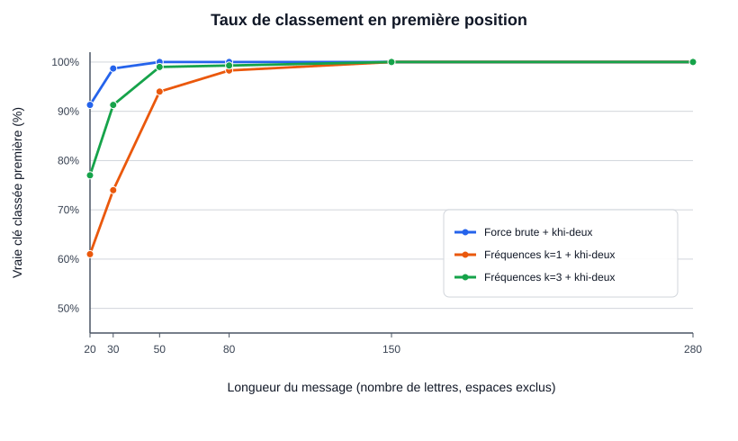
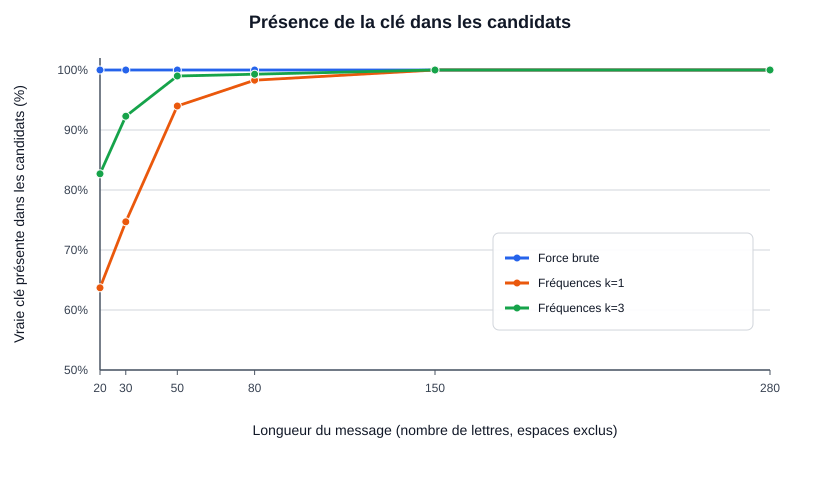

# Casser un code affine

**Auteur : Enes Avsar**  
**Travail individuel**

## 1. Objectif

Ce projet étudie le chiffrement affine. Chaque lettre est convertie en nombre de 0 à 25, puis chiffrée avec la formule :

`y = (a × x + b) modulo 26`

La valeur `a` doit être première avec 26 pour que le chiffrement soit réversible. Il existe 12 valeurs valides de `a` et 26 valeurs possibles de `b`, soit **312 clés**.

Le projet compare deux méthodes pour essayer de retrouver la clé :
- **Force brute** : teste les 312 clés et trie les textes déchiffrés avec le score du khi-deux.
- **Attaque par fréquences** : suppose que l'une des `k` lettres chiffrées les plus fréquentes correspond à E, pour `k = 1, 2, 3, 5`. Elle examine donc en général 12, 24, 36 ou 60 clés.

Le score du khi-deux compare les fréquences observées dans un texte déchiffré aux fréquences attendues en français. Un score plus faible signifie que les deux distributions sont plus proches ; cela ne prouve pas à lui seul que le texte est le bon.

## 2. Lien avec le TP5

Le TP5 fournit déjà le PGCD, l'inverse modulaire, les clés valides, le nettoyage des lettres et une première attaque par fréquences. Le projet réutilise ces fonctions mathématiques et le nettoyage du TP5.

Je ne réutilise pas directement `toutes_les_cles` dans les expériences de masse : elle reconstruit chaque texte candidat. Ici, je compte les lettres chiffrées une seule fois et permute ces comptes pour calculer le score de chaque clé plus efficacement. L'attaque par fréquences généralise `casser_par_frequences` en testant plusieurs valeurs de `k`. Le projet ajoute ainsi le score statistique, des variantes de l'attaque et un protocole d'expérience reproductible.

Le chiffrement conserve les espaces et la ponctuation pour rendre le message lisible. Pour calculer les fréquences, les fonctions d'attaque ne gardent que les lettres A à Z.

## 3. Lancer le projet

Depuis la racine de ce dossier :

```bash
python -m pip install -r requirements.txt
python -m unittest projet.test_projet -v
python -m tp.test_solutions
python -m projet.main
```

La commande `python -m projet.main` lance **300 essais pour chacune des longueurs 20, 30, 50, 80, 150 et 280 lettres**, soit 1 800 essais. Cinq paragraphes français de thèmes différents sont utilisés : apprentissage, ville, nature, lecture et voyage. Pour chaque essai, le programme choisit une fenêtre contenant exactement le nombre demandé de lettres, puis tire une clé valide au hasard. La graine `20261025` permet de reproduire la même série. Les fenêtres peuvent se chevaucher ; l'expérience ne prétend donc pas représenter tous les textes français possibles.

Le programme écrit les mesures dans `projet/resultats/experiences.csv` et génère trois graphiques en PNG et SVG :
- `taux_reussite.png` et `taux_reussite.svg` : taux où le score du khi-deux classe la vraie clé première, pour la force brute et les variantes `k=1` et `k=3`.
- `presence_cle.png` et `presence_cle.svg` : taux où la vraie clé est présente dans la liste des candidats.
- `nombre_cles.png` et `nombre_cles.svg` : nombre moyen de clés examinées.

### Graphiques





### Comment les graphiques SVG sont faits

Le fichier `projet/graphique.py` utilise **Matplotlib**. Le code crée une figure, ajoute les courbes ou les barres, les axes, le titre et la légende, puis sauvegarde le graphique en deux formats. Les deux SVG publiés ici sont des aperçus vectoriels des taux calculés par le programme ; un nouveau lancement régénère les SVG et les PNG à partir des résultats CSV :

```python
plt.savefig(dossier / "taux_reussite.png", dpi=160)
plt.savefig(dossier / "taux_reussite.svg")
```

Le PNG est une image matricielle, tandis que le SVG est un dessin vectoriel décrit par du texte (axes, lignes, textes et formes). Les deux fichiers sont générés par le programme à partir des résultats du CSV : ils ne sont pas dessinés à la main. L'axe vertical des courbes commence à 50 % pour rendre visibles les différences entre les méthodes, et la légende est placée en bas à droite.

## 4. Résultats observés

Ces résultats proviennent d'une exécution avec la graine `20261025`, 300 essais par longueur et cinq paragraphes français, soit 1 800 essais. Les taux sont arrondis à un chiffre après la virgule. La colonne `k` indique combien de lettres chiffrées les plus fréquentes sont testées comme correspondantes à E.

### La vraie clé est-elle classée première ?

| Lettres du message | Force brute | k = 1 | k = 2 | k = 3 | k = 5 |
|---:|---:|---:|---:|---:|---:|
| 20  | 91,3 % | 61,0 % | 72,3 % | 77,0 % | 83,0 % |
| 30  | 98,7 % | 74,0 % | 87,0 % | 91,3 % | 96,3 % |
| 50  | 100,0 % | 94,0 % | 97,0 % | 99,0 % | 100,0 % |
| 80  | 100,0 % | 98,3 % | 99,0 % | 99,3 % | 100,0 % |
| 150 | 100,0 % | 100,0 % | 100,0 % | 100,0 % | 100,0 % |
| 280 | 100,0 % | 100,0 % | 100,0 % | 100,0 % | 100,0 % |

### La vraie clé est-elle présente parmi les candidats ?

| Lettres du message | Force brute | k = 1 | k = 2 | k = 3 | k = 5 |
|---:|---:|---:|---:|---:|---:|
| 20  | 100,0 % | 63,7 % | 77,7 % | 82,7 % | 90,3 % |
| 30  | 100,0 % | 74,7 % | 87,7 % | 92,3 % | 97,3 % |
| 50  | 100,0 % | 94,0 % | 97,0 % | 99,0 % | 100,0 % |
| 80  | 100,0 % | 98,3 % | 99,0 % | 99,3 % | 100,0 % |
| 150 | 100,0 % | 100,0 % | 100,0 % | 100,0 % | 100,0 % |
| 280 | 100,0 % | 100,0 % | 100,0 % | 100,0 % | 100,0 % |

### Nombre moyen de clés examinées

| Méthode | Clés examinées en moyenne |
|---|---:|
| Force brute | 312 |
| Fréquences k = 1 | 12 |
| Fréquences k = 2 | 24 |
| Fréquences k = 3 | 36 |
| Fréquences k = 5 | 60 |

Sur les 1 800 essais, la force brute a inclus la vraie clé **1 800 fois sur 1 800 (100 %)**. Le score du khi-deux l'a classée première dans **1 770 cas sur 1 800 (98,3 %)**. Cela montre qu'énumérer toutes les clés garantit que la bonne est dans la liste, mais pas que le classement statistique la place toujours en première position.

Pour l'attaque `k=1`, à partir de 50 lettres, le taux « clé présente » est identique au taux « classée première » dans cette série : quand l'hypothèse sur E permet de générer la vraie clé, le score du khi-deux la place première parmi les candidats produits dans ces essais. C'est une observation sur ces cinq textes et cette graine, pas une garantie pour tous les messages français.

### Marge d'incertitude

Chaque taux par longueur repose sur `n = 300` essais. J'utilise l'intervalle de Wilson à 95 % pour donner une idée de l'incertitude d'échantillonnage d'un taux : autour de 50 %, la marge est d'environ **± 5,6 points de pourcentage**. Par exemple, pour la force brute à 20 lettres, 274 succès sur 300 donnent un taux de 91,3 % et un intervalle de Wilson d'environ **[87,6 % ; 94,0 %]**. À 300 succès sur 300, le taux observé est 100 %, mais la borne basse de l'intervalle est environ 98,7 %.

Cette marge décrit seulement l'incertitude liée au nombre d'essais. Elle ne corrige pas le fait que les fenêtres sont tirées de cinq paragraphes seulement et peuvent se chevaucher : on ne peut pas extrapoler ces résultats à tous les styles d'écriture, toutes les langues ou tous les textes.

## 5. Exemple d'échec de k = 1

La phrase suivante sert de cas d'essai : « Les habitants partagent des habitudes, mais ils n'utilisent pas tous les mêmes itinéraires ni les mêmes services. »

Après normalisation en A-Z, la lettre S apparaît **16 fois** et E **15 fois** : S dépasse E d'une occurrence. L'attaque `k=1` suppose que la lettre chiffrée la plus fréquente correspond à E ; dans ce cas, elle suppose à tort que l'image chiffrée de S correspond à E, et la vraie clé n'est pas dans ses candidats.

Avec `k=3`, les trois lettres chiffrées les plus fréquentes sont testées comme pouvant correspondre à E. La lettre chiffrée correspondant réellement à E est alors prise en compte ; pour ce cas construit exprès, la vraie clé est présente et le score du khi-deux la classe première. Ce test explique un mécanisme possible d'échec, mais une seule phrase n'est pas représentative de tous les textes français.

## 6. Limites

- Les expériences utilisent cinq paragraphes français ; ils couvrent quelques thèmes mais ne représentent pas tous les sujets ou styles.
- Les fréquences théoriques sont des fréquences françaises arrondies puis normalisées. Elles ne conviennent pas automatiquement à une autre langue.
- Le khi-deux compare seulement les fréquences individuelles : il ne tient pas compte de l'ordre des lettres, des syllabes ni des mots.
- Les espaces et la ponctuation sont conservés dans le message chiffré. Cela révèle la longueur des mots et la structure des phrases.
- Une graine fixe facilite la reproduction des mesures, mais les 1 800 essais restent un échantillon de situations possibles et certaines fenêtres peuvent se chevaucher.
- Les temps de calcul ne sont pas comparés : pour 26 lettres et des messages courts, les petites différences de temps ne permettraient pas de tirer une conclusion solide.
- Le chiffrement affine est un outil pédagogique, pas une méthode destinée à protéger des données réelles.

## 7. Utilisation de l'IA et vérification

J'ai utilisé une aide IA pour proposer une structure initiale des attaques, du protocole expérimental et des tests. J'ai vérifié le fonctionnement par les tests automatisés du dépôt : réversibilité du chiffrement, nombre de clés valides, rejet des paramètres invalides, échec de `k=1` sur un texte construit et cohérence entre le score optimisé et le score recalculé à partir du texte candidat. J'ai aussi vérifié que le programme distingue la présence de la clé de son classement par le khi-deux.

Une première version avait une faiblesse méthodologique : elle traitait des essais issus du même extrait comme s'ils étaient des situations indépendantes et tirait une conclusion trop forte sur l'effet de la longueur. J'ai remplacé ce protocole par cinq paragraphes, des fenêtres aléatoires et des clés tirées au hasard avec une graine fixe. Les chiffres de ce README proviennent de cette nouvelle exécution ; les tests automatisés et les 1 800 essais ont été exécutés avec cette version.
