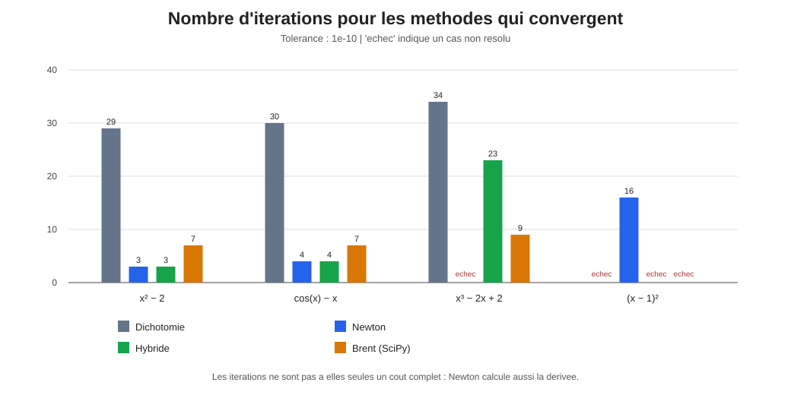

# Solveur d'équations

Nom : à compléter  
Groupe : à compléter

Le but est de comparer plusieurs façons de trouver la racine d'une fonction : la dichotomie, Newton et une méthode qui combine les deux. J'ai aussi ajouté `brentq` de SciPy pour avoir un point de comparaison.

## Lancer le programme

À la racine du dépôt, dans le terminal :

```bash
python -m pip install -r requirements.txt
python -m projet.main
```

Pour lancer les tests :

```bash
python -m unittest projet.test_methodes -v
```

Le programme affiche les résultats dans le terminal. Il crée aussi un fichier CSV et des graphiques dans `projet/resultats/`.

## Quelques résultats

Les tests ont été faits avec une tolérance de `1e-10`.

- Pour `x² - 2`, Newton trouve la racine en 3 itérations. La dichotomie en prend 29.
- Pour `cos(x) - x`, Newton converge en 4 itérations, contre 30 pour la dichotomie.
- Pour `x³ - 2x + 2`, Newton revient à son point de départ et le programme détecte le cycle. La méthode hybride trouve une racine en 23 itérations, alors que Brent en prend 9.
- Pour `(x - 1)²`, la dichotomie et les méthodes qui ont besoin d'un changement de signe ne fonctionnent pas avec l'intervalle choisi. Newton trouve la racine en 16 itérations.



## Ce que j'en retiens

Newton est rapide quand il converge, mais il ne marche pas avec tous les points de départ. La méthode hybride arrive à récupérer le cas où Newton fait un cycle, mais elle n'est pas toujours la plus rapide. Sur cet exemple, Brent fait moins d'itérations.

Il y a aussi une limite avec la racine double : la dichotomie a besoin d'un changement de signe entre les deux bornes. Les résultats dépendent donc de la fonction et de l'intervalle choisi. Avec seulement quatre fonctions, on ne peut pas dire que la méthode hybride est toujours meilleure.

Une IA m'a aidé à organiser et à écrire une partie du code. Je dois vérifier les résultats et être capable d'expliquer les méthodes utilisées.
