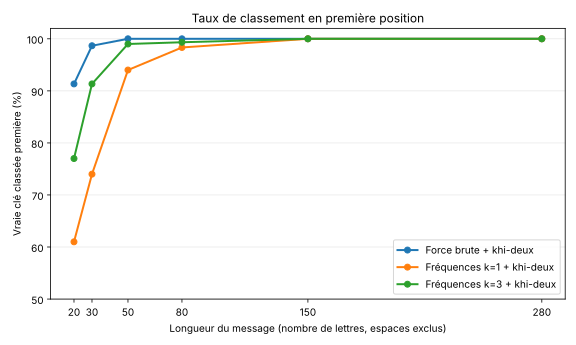

# Casser un chiffrement affine

Enes Avsar, groupe A1, travail individuel.

Le chiffrement affine code chaque lettre avec `y = (a*x + b) mod 26`. Comme `a` doit être premier avec 26, il y a 312 clés possibles.

Je compare deux attaques :
- la force brute : on teste les 312 clés et on garde le texte dont les fréquences de lettres ressemblent le plus au français (score du khi-deux) ;
- l'attaque par fréquences : on suppose qu'une des `k` lettres les plus fréquentes du message est un E, ce qui ne laisse que 12 clés par lettre testée.

Ma question : à partir de combien de lettres on retrouve la clé, et est-ce que l'attaque par fréquences est fiable ?

Je réutilise les fonctions du TP5 (PGCD, inverse modulaire, nettoyage du texte).

## Lancer

```bash
python -m unittest projet.test_projet -v
python -m projet.main
```

`projet.main` fait 300 essais par longueur (20 à 280 lettres) sur des morceaux de trois paragraphes, avec des clés tirées au hasard (graine 20261025). Les résultats sont dans `resultats/`.

## Résultats



Pourcentage d'essais où la bonne clé est classée première :

| Lettres | Force brute | k = 1 | k = 3 | k = 5 |
|---:|---:|---:|---:|---:|
| 20 | 96,7 % | 58,7 % | 82,7 % | 90,0 % |
| 30 | 98,3 % | 75,0 % | 91,3 % | 96,7 % |
| 50 | 100 % | 89,3 % | 98,0 % | 99,3 % |
| 80 | 100 % | 97,0 % | 99,3 % | 100 % |
| 150 et 280 | 100 % | 100 % | 100 % | 100 % |

Ce que j'en retiens :
- La force brute a toujours la bonne clé dans sa liste, mais le khi-deux la classe mal 15 fois sur 1 800, surtout sur les messages courts.
- Avec k = 1, quand ça rate, c'est presque toujours parce que E n'était pas la lettre la plus fréquente. À partir de 50 lettres, si la clé est parmi les 12 candidats, elle est toujours classée première.
- k = 3 est un bon compromis : 36 clés testées au lieu de 312, et plus de 98 % de réussite dès 50 lettres.

Exemple d'échec : la phrase « Les habitants partagent des habitudes, mais ils n'utilisent pas tous les mêmes itinéraires ni les mêmes services. » a 16 S pour 15 E, donc k = 1 se trompe. k = 3 trouve la bonne clé (c'est vérifié dans les tests).

## Limites

Je n'ai utilisé que trois paragraphes, donc les 100 % sur les longs messages valent surtout pour ces textes. Avec 300 essais, les taux ont une marge d'environ ±5 points. Le khi-deux ne regarde pas l'ordre des lettres, et j'ai laissé les espaces dans le message chiffré, ce qui donne la longueur des mots.

## Aide utilisée

Je me suis aidé d'un assistant IA pour structurer le code et les tests. Ma première version des expériences réutilisait toujours le même début de texte, je l'ai refaite avec des extraits tirés au hasard. J'ai lancé moi-même les tests et les expériences.
