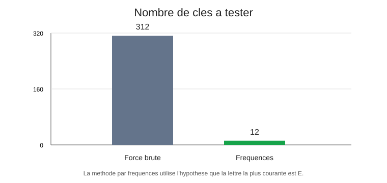
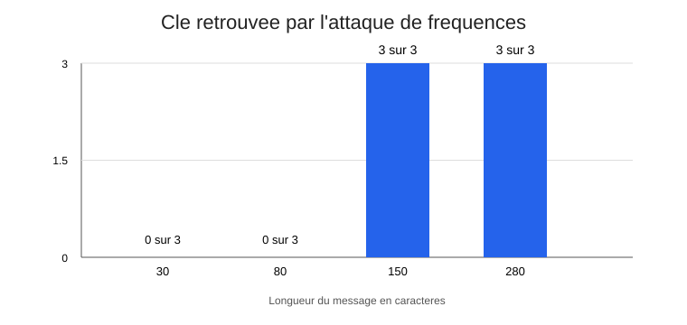

# Casser un code affine

J'ai choisi ce sujet car il utilise le PGCD et les calculs modulo vus en TP. Le programme chiffre un message, le dechiffre, puis essaie de retrouver la cle.

## Lancer

Depuis le dossier principal :

```bash
python -m pip install -r requirements.txt
python -m projet.main
python -m unittest projet.test_projet -v
```

Le programme enregistre les essais dans `projet/resultats/experiences.csv` et cree deux graphiques.

## Ce que j'ai teste

La force brute teste les 312 cles possibles. L'attaque par frequences suppose que la lettre la plus courante correspond a E. Elle ne garde alors que 12 cles possibles, mais son hypothese peut etre fausse.

Dans mes essais, la force brute a classe la vraie cle en premier pour les 12 messages testes. L'attaque par frequences a retrouve la cle dans 6 essais sur 12 : elle s'est trompee sur les textes de 30 et 80 caracteres, et a reussi pour ceux de 150 et 280 caracteres. Le resultat depend donc de la longueur du texte et des lettres presentes.





Les temps sont dans le CSV, mais ils peuvent varier selon l'ordinateur. La force brute essaie toutes les cles et trie les resultats avec un score de frequences. Ce score n'est pas parfait, mais il permet de classer les textes proposes.

Le chiffrement affine est facile a casser et ne doit pas servir a proteger de vraies donnees. Les frequences de lettres ne suffisent pas toujours a reconnaitre un texte, surtout s'il est court.

Une aide IA a servi a organiser une partie du code. Je dois relire les fonctions et pouvoir expliquer les tests et les resultats.
